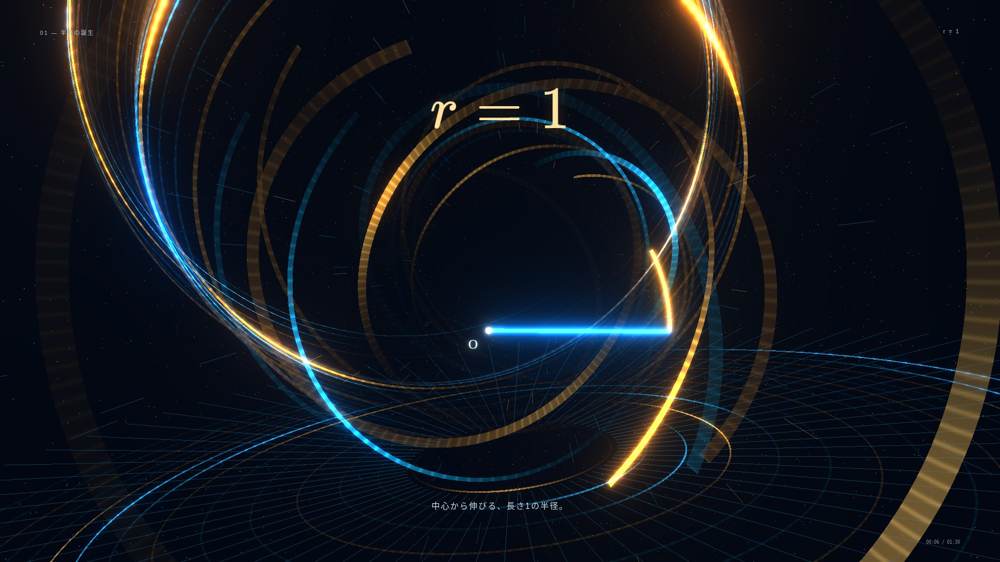
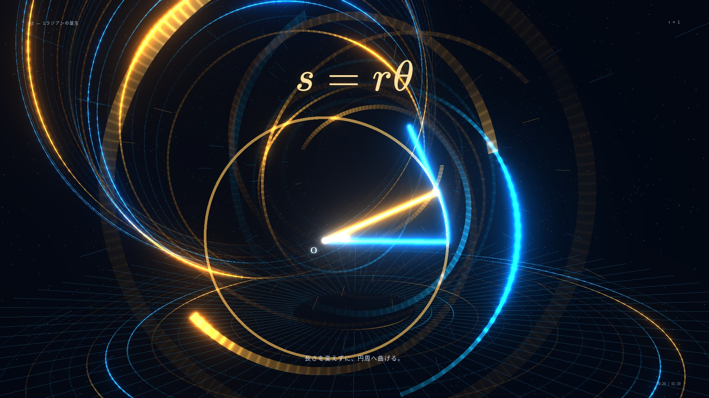
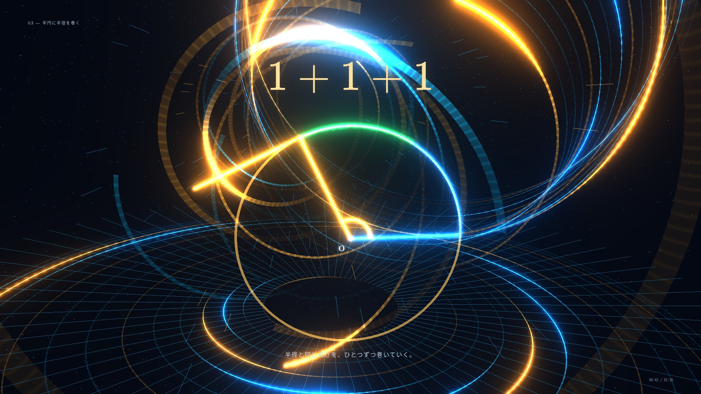
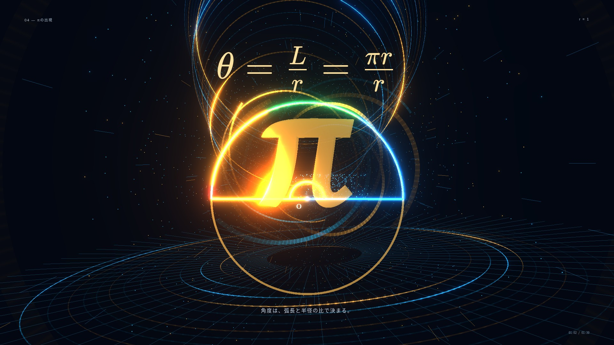
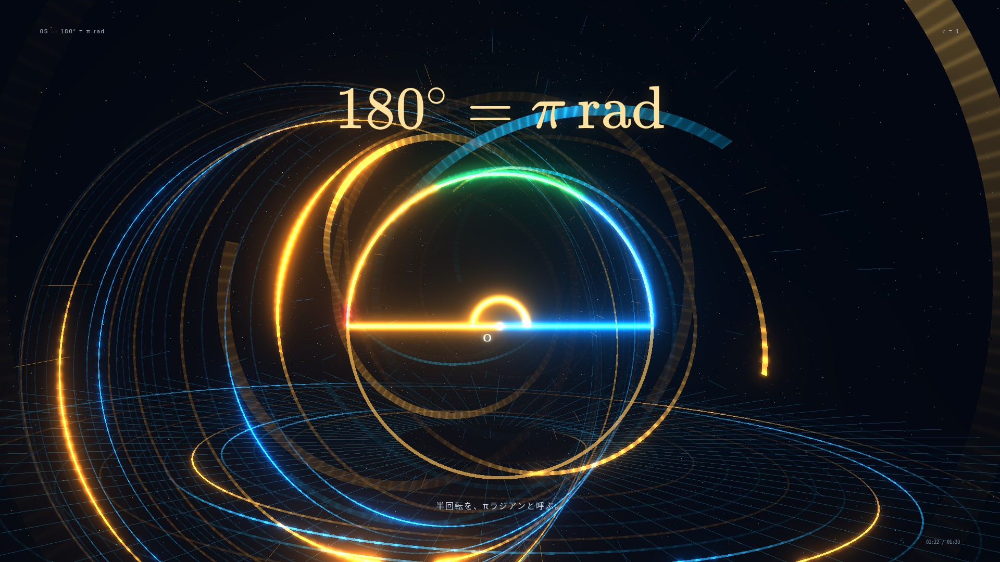
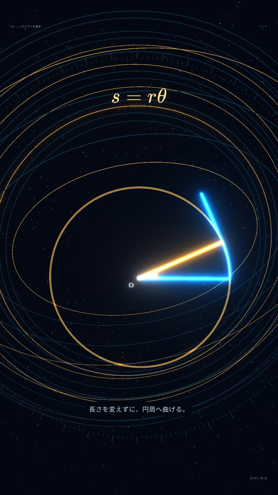
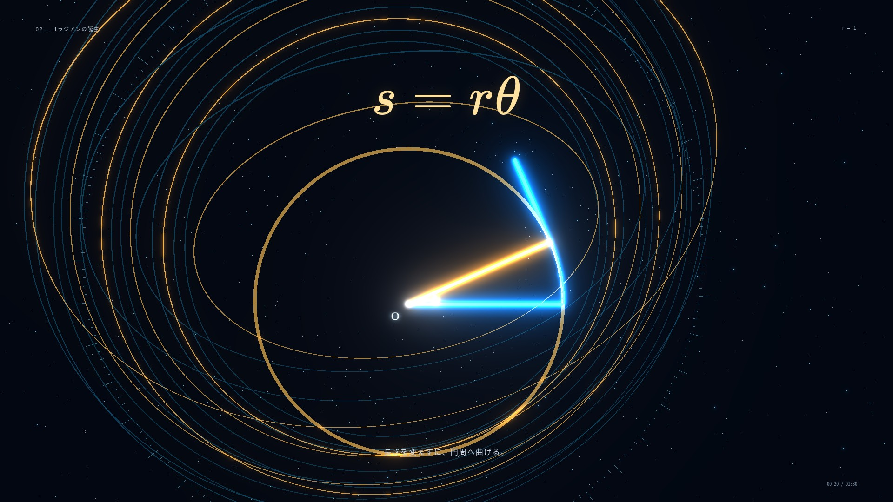

# 検証記録：ラジアンの誕生

Chromium + SwiftShader で実際にWebGLを描画した画面です。背景画像を動画に使用しているものではありません。

| 時刻 | 確認対象 | 実画面 |
|---|---|---|
| 6秒 | 半径・立体背景 |  |
| 20秒 | 長さを保つ連続した巻き付け |  |
| 42秒 | 青・緑・黄金の帯 |  |
| 62秒 | 立体πと分数式・粒子 |  |
| 82秒 | 180° = π rad |  |

`browser.json` は0〜90秒を1秒刻みの91点で描画した結果です。全5シーン、カメラ位置・背景円環の変化、再生・一時停止・最初から、390px幅での式の収まり、WebGL非対応表示を確認。JavaScript例外は0件でした。

`mathematics.json` は24条件で帯の長さを各2万分割して測った結果。最大誤差は約2.45×10⁻¹⁰です。

## 全体テストの結果

`npm run build` は成功。`npm test` は308件中305件成功、3件失敗。失敗対象のファイルはいずれも本PRで変更していません。単独での再実行でも同じ3件が失敗しました。

- `src/materials.test.ts`: 既存 `triangle-789-cinematic` のサムネイル未登録。
- `materials/region-circle-radius/src/math.test.ts`: 既存の領域判定の期待値不一致。
- `materials/math3-lineage/render.test.js`: 既存の全30シーン検査が5秒制限を超過。

iPhoneは390px幅のChromiumでレイアウトを確認したもので、実機Safari試験ではありません。実機の60fps維持は未検証です。

## 縦型30秒MP4

1080×1920、H.264/yuv420p、30fps、900フレーム、正確に30.000秒。ファイルサイズ47,413,759 bytes。FFmpegによる全編デコードはエラーなし。書き出し後、Noto Sans CJK JPによる36pxの説明字幕を重ねてスマートフォンでの可読性を確保しています。

動画のメタデータは `video.json`、ハッシュは `video.sha256`。ブラウザで1080×1920・30秒のメタデータ、15秒地点からの実再生、ダウンロード成功、保存したファイルのSHA-256一致を確認済みです。結果は `video-browser.json` に保存しています。

## 背景演出の改訂

微小な円環の回転を主体とした旧版から、奥へ連なる24環、水平の15環と放射線、7本の螺旋光、4200粒子、110本の光跡、完成時刻に発生する衝撃波へ変更しました。中央と数式の背後の光量を抑え、奥行きと外周の運動を強調しています。

[新版の8秒モーションプレビュー](../../../../public/media/birth-of-radian-background-preview.mp4)（960×540・30fps、本編16〜24秒）

| 旧版20秒 | 新版20秒 |
|---|---|
|  |  |

背景領域（左右の外周と画面下部）の画像を各シーンで1秒差で比較した結果、明確に変化した画素は10.86〜27.59%でした。静止背景に数式だけが動いている状態ではないことを画像でも確認しています。帯の完成34.6秒でパルスが最大になり、1秒後には減衰すること、WebGLシェーダーにエラーがないことも確認済みです。記録は background.json。
