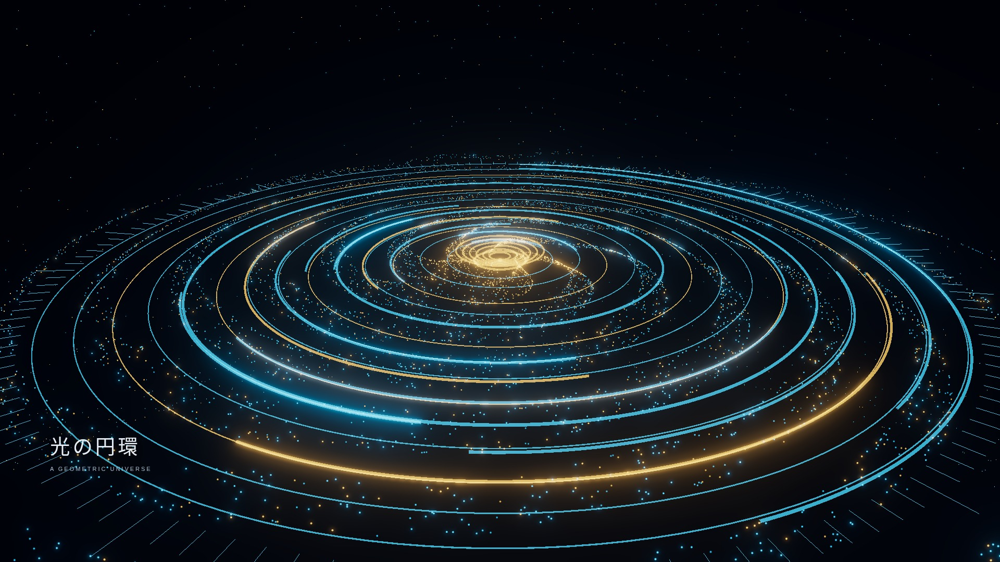
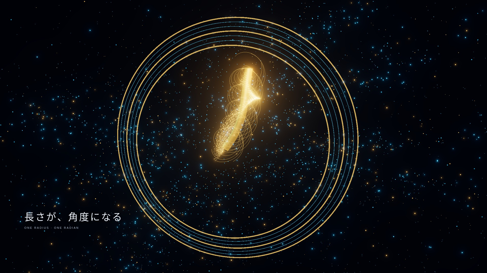
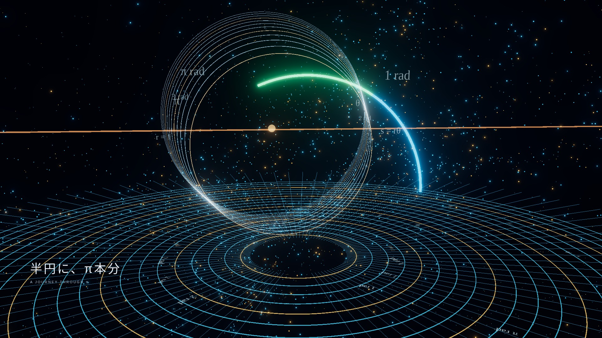
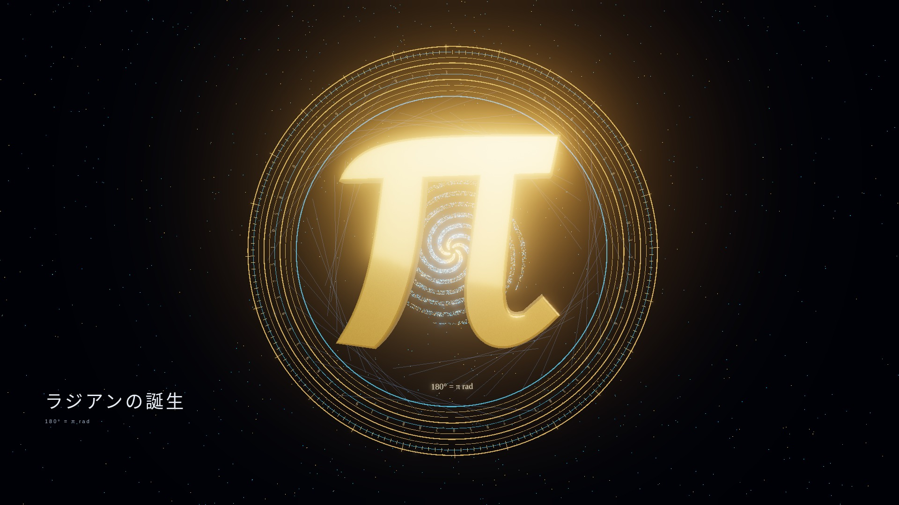

# 参考画像の4構図を動かす24秒映画

Three.js/WebGLで円環・粒子・帯・数式・πを再構築した4ショットの映画です。画像そのもののパン・ズームは使用していません。

| 3秒：円環の宇宙 | 9秒：黄金の帯 |
|---|---|
|  |  |

| 15秒：数式の空間 | 21秒：黄金のπ |
|---|---|
|  |  |

[24秒映画のMP4](../../../../public/media/birth-of-radian-reference-film.mp4)

タイムライン全25点、4つのカメラショット、粒子の時刻変化、再生・一時停止・最初から、帯の長さ保存、WebGLシェーダーを検査しています。結果は browser.json。

出力は1920×1080・24fps・24秒、全576フレーム。MP4は54,209,575 bytes、H.264の4:2:0形式。全編デコードにエラーはなく、ブラウザ再生・ダウンロードと保存ファイルのSHA-256一致を確認済みです。メタデータは video.json、再生・保存の記録は video-browser.json、ハッシュは video.sha256。実機iPhoneと60fps維持は未検証です。

4ショットそれぞれの1秒差の画面を比較し、RGB差の合計45超の画素を検査しています。カメラ・粒子・帯・照明が時間に沿って変化し、静止画の切り替えではないことを確認しました。最終ビルドも成功しています。
